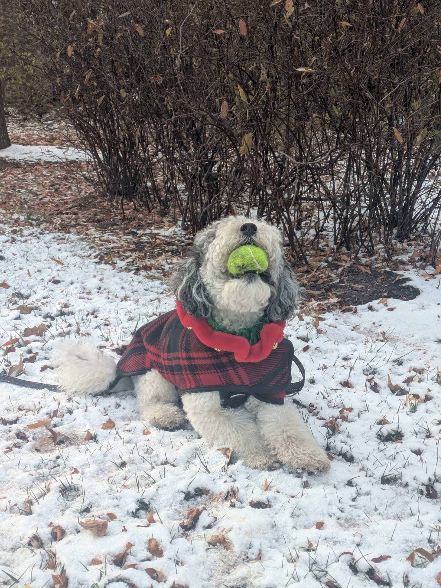

## Hi, I'm Divyaa 👋

I'm a biologist turned bioinformatician, currently a Bioinformatics Postdoc at the University of Virginia School of Medicine. My research focuses on understanding gene regulation and its role in diseases such as prostate cancer and COPD.

I did my PhD in Peter Fraser's lab at Florida State University, where I studied how chromosomes pair and organize themselves during meiosis using single-cell Hi-C. I started out mostly at the bench, optimizing the technique and generating data, before gradually moving into computational analysis. Along the way, I discovered how much I enjoyed exploring data, trying different approaches, and seeing what I could learn from them!

## 🔍 What interests me 

I'm interested in 3D genome organization, how genetic variants influence gene regulation, and how these processes contribute to human disease.

I'm also exploring AI in genomics, particularly how models can help identify functional noncoding variants, link them to their target genes, and how well these predictions hold up against experimental data. I'd also like to explore how existing models can be adapted to improve their predictions and make them more useful for studying disease-associated genetic variation.

## Around here 🛠️

You'll find code from my research, analyses I've worked on, and tools I've tried along the way. Mostly genomics, data exploration, and the occasional experiment with something new!

## 🐶 Meet Akiro!

When I'm not working, I'm usually out walking or hiking with Akiro, my favorite adventure buddy. He's the sweetest fellow, with one very serious obsession: his squeaky tennis ball, which he refuses to go anywhere without!

  
